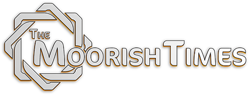

tinkerer hobbyist with a knack for automating everything.
I design and build tailor-made systems that tie business tools together (on their own !)
#### currently working on:

  
the project I cherish the most <3, a French and English magazine on Moroccan culture, heritage and recently, news.
Built on Webflow, by a dedicated community, with a revamp and an iOS app on the way.

 

 **Sküma® iOS app** 
A companion app for Sküma® Water's MY™ Station. Suggests a daily hydration
target, logs drinks to Apple Health, tracks filter and device upkeep and allows for seamless management of subscriptions / orders etc… 

 

 

 **SyncMyLibs** (work in progress) 
A macOS app made for managing multiple libraries at once, and I won't spoil the features just yet.
 

#### What I build for people

Integrated systems and automations made to fit how a team already works:
dashboards, pipelines and glue between the services they use, so routine
work happens without anyone pushing it.

#### Other/random stuff

**[4chan Archives Enhancer](https://github.com/Amerruki/4Chan-Archives-Enhancer)** 
Used to wish the archives had 4chan X so I made something similar.
